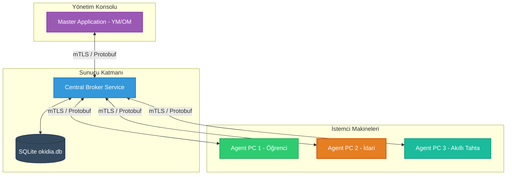

# 🏫 OKIDIA — Güvenli Sınıf ve Sistem Yönetim Platformu

> Okidia; okul, sınıf ve kurumsal bilgisayar ağlarını tek bir merkezden izlemek, yönetmek ve denetlemek amacıyla geliştirilmiş, ultra yüksek performanslı, mTLS (mutual TLS) güvenlikli ve C++20 / Qt6 tabanlı yeni nesil bir **Sistem Yönetim ve İzleme Platformu**dur.

---

## 🏛️ Üçlü Mimari Tasarımı (3-Tier Architecture)

Okidia, ağ üzerindeki yükü minimize etmek ve güvenliği en üst seviyede tutmak için **Broker**, **Master** ve **Agent** olmak üzere üç katmanlı bir mimariye sahiptir:



*   **Broker (Merkez):** Tüm ağ trafiğini yöneten, yetkilendirmeleri (mTLS & CA) üstlenen, komutları hedeflere dağıtan ve veritabanı (SQLite) işlemlerini asenkron olarak yürüten merkezi sunucu servisidir.
*   **Master (Yönetici / Öğretmen Konsolu):** Sistem Yöneticilerinin (YM) ve Öğretmenlerin (OM) ağdaki tüm bilgisayarları canlı izleyebildiği, komut gönderebildiği, ekranları kilitleyip sohbet edebildiği zengin içerikli Qt6 GUI masaüstü uygulamasıdır.
*   **Agent (İstemci / AC):** Yönetilen tüm bilgisayarlarda arka planda çalışan ve işletim sistemi seviyesinde çalışan ana daemon servisidir (`okidia-agent`) ve kullanıcı oturumunda çalışan arayüz bileşenidir (`okidia-tray`).

---

## 🚀 Öne Çıkan Özellikler

*   🖥️ **Canlı Ekran İzleme & Uzak Kontrol:** Yüksek kare hızlarında differential JPEG tile aktarımı ve fare-klavye olaylarının anlık iletimi.
*   💬 **Çok Kanallı Sohbet Mimarisi:** Öğretmenler Odası, Sınıf Odası, Grup Odası ve onay mekanizmalı/kilitlenebilir Özel Sohbet kanalları.
*   🛡️ **3 Farklı İstemci Modu:** Rolüne göre davranış değiştiren esnek istemci tasarımı (Öğrenci PC, Gizlilik korumalı İdari PC ve Akıllı Tahta).
*   🌐 **Ağ & Uygulama Filtreleme:** İsim veya SHA256 bazlı uygulama engelleme; URL bazlı beyaz/kara liste web filtreleri.
*   📝 **Sınav Modu:** Sınav süresince ekran ve giriş aygıtlarını kilitleyen, web erişimini tamamen kısıtlayan güvenli test ortamı.
*   🔊 **Ses Kontrolü & Yayın:** Mikrofon veya dosya üzerinden tüm ağa veya sınıfa anlık ses yayını yapabilme.
*   🔑 **Yüksek Güvenlik Standartları:** Çift taraflı mTLS şifreleme, Argon2id şifre özetleme, AES-256 veritabanı yedekleme ve sistem audit loglama.

---

## 🛠️ Teknoloji Yığını

Platform, maksimum verim ve kararlılık için tamamen modern, yerel (native) teknolojiler kullanılarak sıfırdan inşa edilmiştir:

*   **Çekirdek Dil:** C++20
*   **Arayüz & Framework:** Qt6 (Core, Widgets, Network, Concurrent, Multimedia, Sql)
*   **Serileştirme:** Google Protocol Buffers (Protobuf v3)
*   **İletişim & Güvenlik:** OpenSSL (mTLS & CSR ile otomatik sertifika onay akışı)
*   **Uzak Bağlantı:** libssh2
*   **İşletim Sistemi Servisi:** Linux systemd entegrasyonu

---

## 📂 Dizin Yapısı

```
okidia/
├── agent/                # İstemci servisi ve Tray uygulaması kaynak kodları
├── broker/               # Merkezi koordinasyon sunucusu kaynak kodları
├── master/               # Yönetici / Öğretmen arayüzü kaynak kodları
├── common/               # Tüm bileşenlerce paylaşılan ortak modüller
│   ├── db/               # SQLite veritabanı erişim sınıfı (OkidiaDatabase)
│   ├── network/          # TCP, TLS, LocalSocket ağ modülleri
│   ├── protocol/         # Protobuf mesaj tanımları (messages.proto)
│   └── utils/            # Logger, şifreleme, zaman yardımcıları
├── dev-docs/             # Derinlemesine geliştirici dökümantasyonu
├── packaging/            # Debian/Linux dağıtım ve paketleme scriptleri
└── CMakeLists.txt        # Proje ana derleme sistemi
```

---

## 📖 Geliştirici Belgeleri

Projenin tüm detaylarını adım adım açıklayan modern ve temiz geliştirici rehberleri:

1.  📐 **[Sistem Mimarisi ve mTLS Yaşam Döngüsü](dev-docs/ARCHITECTURE.md)** — Ağ protokolleri, sertifika keşif (Discovery) akışı ve pending command mantığı.
2.  💾 **[SQLite Veritabanı Şeması (v7)](dev-docs/DATABASE_SCHEMA.md)** — 13 SQLite tablosunun alanları, indeksleri ve C++ veritabanı API metotları.
3.  💬 **[Sohbet ve İletişim Kuralları](dev-docs/CHAT_SYSTEM.md)** — Odalar, kilitler, canlı geçmiş sınırları ve üye durum emojileri.
4.  💻 **[Kurulum ve Geliştirici Kılavuzu](dev-docs/DEVELOPER_GUIDE.md)** — CMake ile derleme, 3 tip istemci modu karşılaştırması ve gelecek v2 yol haritası.
5.  📂 **[Kod Tabanı Kataloğu](dev-docs/CODEBASE_CATALOG.md)** — Hangi dosyanın ve sınıfın hangi sorumluluğa sahip olduğunu gösteren rehber.
6.  🗺️ **[Yol Haritası ve Gelecek Özellikler](dev-docs/ROADMAP.md)** — VM klon algılama koruması, E2EE sohbet kurgusu ve toplu SSH yönetim komutları listesi.

---

## ⚡ Hızlı Başlangıç

### 1. Bağımlılıkların Kurulması (Ubuntu/Debian)
```bash
sudo apt update
sudo apt install build-essential cmake qt6-base-dev qt6-multimedia-dev \
                 libssl-dev libssh2-1-dev protobuf-compiler libprotobuf-dev \
                 libsystemd-dev openssl
```

### 2. Projenin Derlenmesi
```bash
mkdir build && cd build
cmake -DCMAKE_BUILD_TYPE=Release ..
make -j$(nproc)
```
Derleme sonucunda `build/` dizini altında `broker/okidia-broker`, `agent/okidia-agent`, `agent/okidia-tray` ve `master/okidia-master` binary dosyaları üretilecektir.

---
*Developed by onurtamer79. Copyright © 2026. All rights reserved.*
