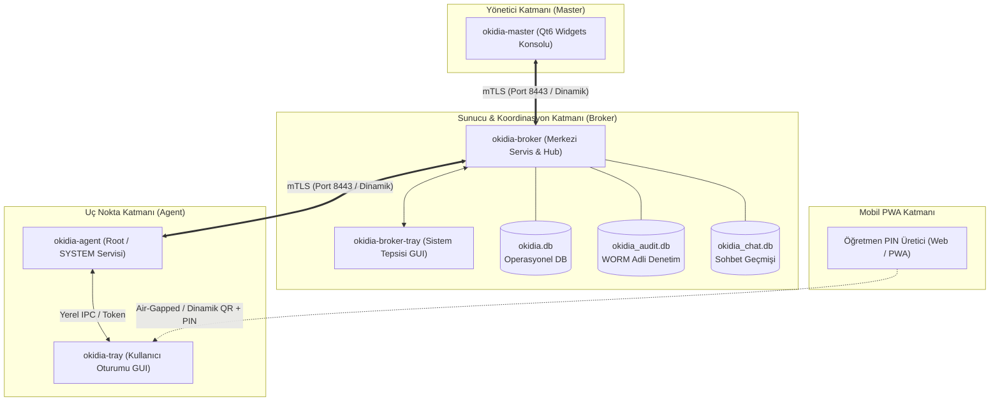
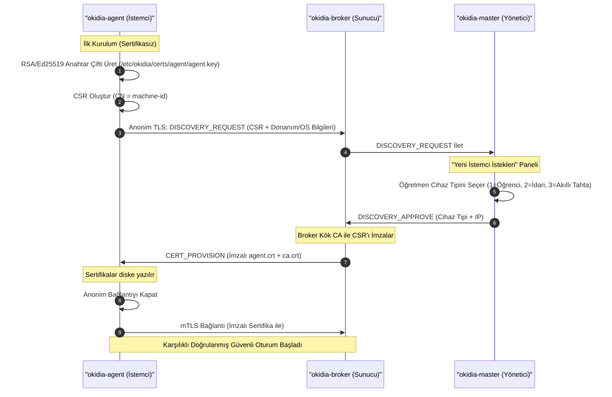
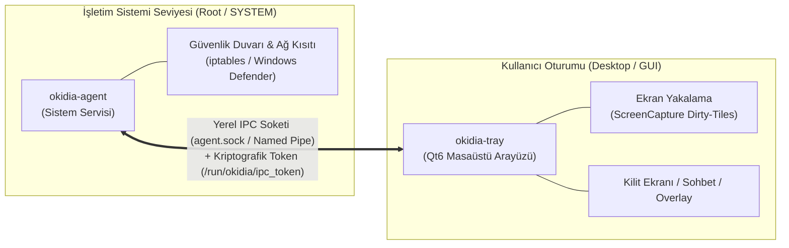
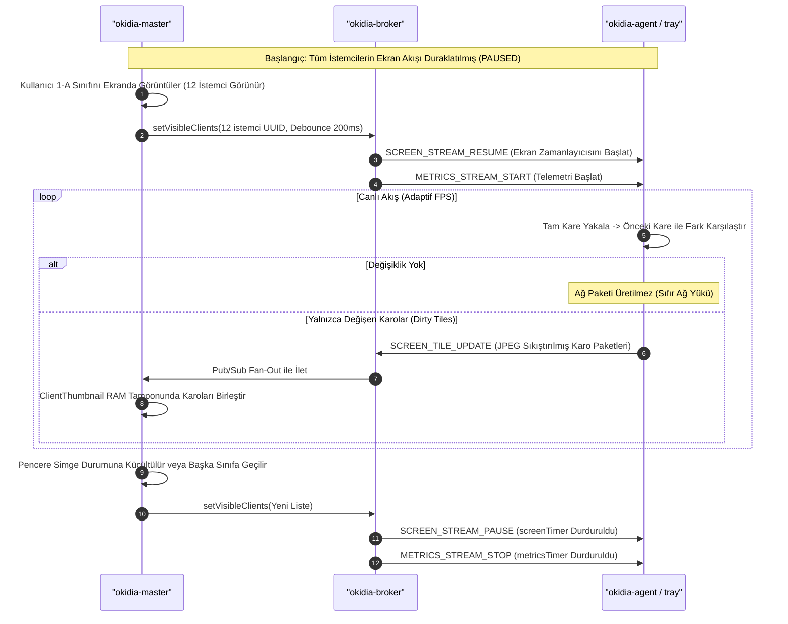
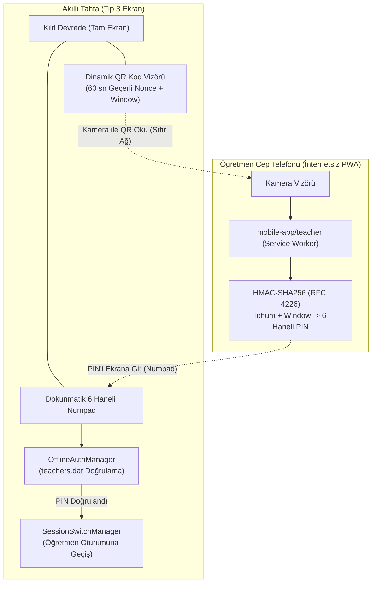
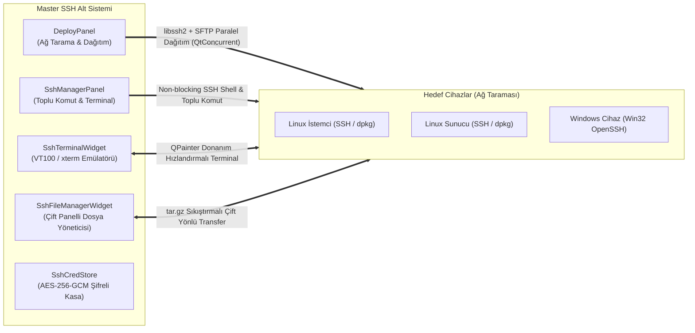

# 📐 OKIDIA Sistem Mimarisi ve İletişim Protokolleri

Bu doküman; Okidia platformunun bileşenler arası ağ topolojisini, güvenlik mimarisini, mTLS kimlik ve kayıt yaşam döngüsünü, iki katmanlı istemci yapısını, talep tabanlı akış optimizasyonunu, 3'lü veritabanı ayrımını ve anti-sabotaj savunma mekanizmalarını derinlemesine incelemektedir.

---

## 1. Mimari Genel Bakış ve Bileşenler

Okidia; yerel okul, üniversite ve kurumsal laboratuvar ağlarında minimum ağ yükü, sıfır konfigürasyon (Zero-Config) ve tavizsiz güvenlik ilkeleriyle çalışan çok katmanlı bir platformdur.



### Temel Platform Bileşenleri:
1. **`okidia-broker` (Merkezi Sunucu & Hub):** Ağdaki tüm cihazların mTLS kimlik doğrulamasını, kayıt onaylarını, Pub/Sub mesaj yönlendirmesini, dijital zil zamanlamasını ve 3 bağımsız SQLite veritabanının yönetimini yürüten çekirdek servistir.
2. **`okidia-agent` (Uç Nokta Sistem Servisi):** Yönetilen bilgisayarlarda (Linux'ta `root`, Windows'ta `SYSTEM` Session 0) çalışan arka plan servisidir. Donanım ve ağ kısıtlamalarını (ekran/girdi kilidi, firewall) işletim sistemi seviyesinde uygular.
3. **`okidia-tray` (Kullanıcı Arayüzü & Ekran Yakalama):** Kullanıcı masaüstü oturumunda veya oturum açma ekranında (Display Manager / Winlogon) çalışan Qt6 GUI uygulamasıdır. Canlı ekran yakalamayı, tam ekran kilit perdelerini ve sohbet penceresini yönetir.
4. **`okidia-master` (Yönetici & Öğretmen Konsolu):** Öğretmenlerin ve yöneticilerin kullandığı zengin arayüzlü (Qt6 Widgets) kontrol panelidir. Dinamik ekran izleme ızgarası, uzaktan kontrol, sınav modu, anons ve SSH yönetim konsolunu barındırır.
5. **Öğretmen PIN Üretici (`mobile-app/teacher`):** Akıllı tahta kilitlerini tamamen internetsiz (Air-Gapped) açmak için HMAC-SHA256 ve RFC 4226 (HOTP) standardında çalışan bağımsız PWA web uygulamasıdır.

---

## 2. Sıfır Yapılandırma ve Dinamik Ağ Keşfi (Zero-Config)

Okidia; statik IP yapılandırmasına veya DNS sunucusu ayarlarına ihtiyaç duymaksızın yerel ağda kendi kendini keşfeder ve bağlar:

```
[İstemci (Agent)] ──(1) mDNS Keşif (_okidia._tcp) ──> [Broker Sunucu]
[İstemci (Agent)] <──(2) Güvenli mTLS Bağlantı ─────> [Broker Sunucu] <── mTLS ──> [Master Konsol]
```

1. **Broker mDNS Anonsu:** Broker sunucusu açıldığında ağ arabirimlerinden `_okidia._tcp` servisini yayınlar. TXT kaydında Broker sürümü ve Kök CA parmak izi (`cafp`) anons edilir. Linux'ta Avahi daemon, Windows'ta ise yerel Qt `QUdpSocket` (224.0.0.251:5353) motoru kullanılır.
2. **Çoklu Ağ Kartı (Multihomed) Desteği:** Broker ve Agent, birden çok ağ kartı (Ethernet, Wi-Fi, USB adaptörleri) bulunan makinelerde tüm aktif arabirimleri dinler ve arayüz değişimlerini anlık algılar.
3. **Ağ İzleme ve Otomatik İyileşme (Network Watcher):** Ağ adaptörü değiştiğinde (örn. Wi-Fi'dan kabloya geçiş veya IP yenilenmesi) `NetworkWatcher` mevcut soketleri kapatıp mDNS keşif sürecini anında baştan başlatır.
4. **L3/VLAN İzolasyonuna Karşı Kademeli Fallback:**
   * Çok katlı veya VLAN ile izole edilmiş kurumsal ağlarda mDNS paketleri yönlendiriciden (router) geçemeyebilir.
   * `AgentDiscoveryCoordinator`, mDNS yanıtı alamadığında kademeli olarak DNS Fallback (`okidia-broker` ve `broker.okidia.local`) sorgularına geçer.
   * Master konsolu ise 2.5 saniye mDNS yanıtı alamazsa otomatik olarak tanımlı Uzak / Tailscale VPN adresine geçiş yapar (Status Bar'da "Uzak Ağ" rozeti aktifleşir).

---

## 3. mTLS Kriptografi, Kayıt ve Kimlik Yaşam Döngüsü (PKI Lifecycle)

Tüm TCP trafiği OpenSSL kullanılarak çift taraflı doğrulama (mutual TLS - mTLS) ile şifrelenir. Sisteme katılım iki aşamalı kriptografik keşif ve onay döngüsüyle gerçekleşir:



### Donanım Eşleme ve VM Klonlama Koruması (Cloning Guard):
* Laboratuvarlarda Clonezilla gibi araçlarla disk imajı klonlandığında `/etc/machine-id` çakışması yaşanır.
* `okidia-agent` ilk kurulumda kimliğini aktif fiziksel ağ kartının MAC adresine (`/etc/okidia/installed_mac`) kilitler.
* Açılışta MAC adresi veya donanım UUID değişikliği tespit edilirse eski sertifikalar otomatik temizlenir, yeni bir kimlik üretilir ve Broker ile temiz bir `DISCOVERY_REQUEST` başlatılır.

### Donanım Saati & RTC Pil Arızası Koruması:
* X.509 sertifikaları geçerlilik tarih aralığına (`notBefore` - `notAfter`) bakar. Anakart BIOS/RTC pili bitmiş cihazlarda saat 1970 veya 2000 yılına dönerek TLS el sıkışmasının çökmesine sebep olur.
* `TIME_SYNC_REQUEST` ve `TIME_SYNC_RESPONSE` protokolüyle Broker sunucusunun UTC zamanı alınır.
* Linux'ta `clock_settime(CLOCK_REALTIME)`, Windows'ta `SetSystemTime` çağrılarak sistem saati düzeltilir ve TLS bağlantısı kurtarılır.
* Cihazın saati her açılışta sıfırlanıyorsa Broker Master'a `CLIENT_HARDWARE_ALERT` uyarısı gönderir.

### İptal ve Yaşam Döngüsü Mesajları:
* **`DISCOVERY_REJECT` (Geçici Ret):** İstek reddedilir; ajan 5 saniye sonra yeniden dener.
* **`DISCOVERY_IGNORE` (Kara Liste):** Ajan kara listeye alınır (`status = 2`). İstekleri Broker tarafından sessizce düşürülür.
* **`CLIENT_REVOKE` (Sertifika İptali):** Master bir istemciyi sildiğinde Broker ajana `CLIENT_REVOKE` gönderir. Ajan yerel sertifikalarını silip anonim keşif moduna döner.
* **`CLIENT_UNINSTALL` (Tamamen Kaldırma):** Ajan servisinin kendini işletim sisteminden tamamen kaldırmasını (Linux `apt purge`, Windows uninstaller) tetikler.

---

## 4. İki Katmanlı İstemci Mimarisi (Two-Tier Agent)

Uç noktalarda güvenlik ve kullanıcı arayüzü gereksinimlerini birbirinden yalıtmak için iki süreçli bir mimari uygulanır:



1. **`okidia-agent` (Servis):**
   * Linux'ta systemd altında `root`, Windows'ta SCM altında `SYSTEM` (Session 0) yetkileriyle çalışır.
   * Broker ile mTLS TCP bağlantısını yönetir, gelen kısıtlamaları uygular ve yerel soket IPC sunucusu (`LocalServer`) açar.
   * Yetkisiz süreçlerin araya girmesini engellemek için her başlatmada rastgele 256-bit oturum tokenı (`/run/okidia/ipc_token`) üretir ve IPC el sıkışmasında (`AGENT_IPC_HANDSHAKE`) doğrular.
   * **Canlı Tray Bekçisi (Watchdog):** Kullanıcı `okidia-tray` sürecini görev yöneticisinden sonlandırsa bile servis bunu saniyeler içinde algılayarak konsol oturumunda arayüzü otomatik olarak yeniden başlatır.

2. **`okidia-tray` (Arayüz):**
   * Kullanıcı oturumunda veya oturum açma ekranında (Display Manager: GDM, LightDM, SDDM / Windows: Winlogon) çalışır.
   * Ekran pencerelerini yakalama, tam ekran kilit perdeleri (`ScreenLockOverlay`, `SmartboardLockOverlay`) ve ses/sohbet bildirimlerini çizer.
   * **State Replay (Oturum Değişiminde Durum Yeniden Oynatma):** Kullanıcı oturum açtığında veya oturum değiştirdiğinde (DM -> Kullanıcı Masaüstü), servis o an aktif olan kilitleri ve ekran FPS ayarını yeni başlatılan tepsi uygulamasına anında yeniden oynatır (replay).

---

## 5. Talep Tabanlı Akış ve Diferansiyel Ekran Mimarisi

Okidia; yüzlerce bilgisayarın bulunduğu ortamlarda okul ağının kilitlenmesini önlemek için **Talep Tabanlı Akış (Demand-Driven Streaming)** ve **Diferansiyel Değişen Karo (Dirty Tile)** teknolojilerini birleştirir.



### Akış Optimizasyonu İlkeleri:
1. **Talep Tabanlı Abonelik:** İstemciler körü körüne ağa ekran veya telemetri basmaz. Master'da o an ekranda görünmeyen veya minimize edilen istemcilerin timer'ları durdurulur (`SCREEN_STREAM_PAUSE`, `METRICS_STREAM_STOP`).
2. **Dirty-Tile Diferansiyel Yakalama:** Ekran 16x16 veya dinamik grid karolarına bölünür. Yalnızca değişen kare blokları JPEG olarak sıkıştırılıp `SCREEN_TILE_UPDATE` ile gönderilir. Statik masaüstlerinde ağ trafiği 0 KB/s seviyesine iner.
3. **Akış Yeniden Başladığında Tam Kare Garantisi:** Akış pause durumundan resume'a geçtiğinde veya yeni bir Master bağlandığında `resetPreviousFrame()` çağrılarak ilk kare mutlaka tam anahtar kare (`SCREEN_FRAME`) olarak üretilir.
4. **Soket Tampon Taşma Koruması (Backpressure):** Soket yazma tamponu 25 MB eşiğini aşarsa (`MAX_BUFFER_SIZE`) ağ tıkanıklığını önlemek için soket korumaya alınır.
5. **Latest-Frame-Only Drop:** Ağda gecikme olduğunda eski ekran kareleri kuyrukta biriktirilmez; doğrudan düşürülerek daima en son yakalanan kare işlenir.
6. **UI Event-Loop Koruma:** `Connection` sınıfında soketten tek seferde maksimum 8 mesaj okunup (`kMaxMessagesPerRead = 8`), devamı `QTimer::singleShot(0)` ile sıraya verilerek Qt arayüz donmaları engellenir.

---

## 6. Protobuf Zarflama, Yönlendirme ve Mesajlaşma

Tüm veri paketleri Google Protocol Buffers (Protobuf v3) ile tanımlanmıştır. Tüm paketler tek bir üst taşıyıcı zarf (**Envelope**) içine sarılır:

```protobuf
message Envelope {
    MessageType type           = 1; // Mesaj tipi (örn. SCREEN_LOCK, CHAT_MESSAGE)
    uint64      sequence_id    = 2; // İstek/yanıt eşleme veya geriye dönük uyumluluk ID'si
    bytes       payload        = 3; // Serileştirilmiş asıl proto mesajı
    string      target_id      = 4; // Hedef Cihaz UUID (boş = Broadcast / Sınıf Yayını)
}
```

### Mesaj Yönlendirme ve Dağıtım Türleri:
* **Tekil Yönlendirme (Unicast):** `target_id` alanında belirli bir cihazın UUID'si bulunur. Broker zarf içeriğini açmadan doğrudan hedef cihazın soketine yazar.
* **Pub/Sub Çoklu Yayın (Fan-Out Multicast):** Master bir sınıfı veya grubu hedef aldığında, Broker `MulticastManager` ile bu gruptaki tüm aktif soketlere tek bir paketi çoğaltarak dağıtır.
* **Çevrimdışı Komut Kuyruğu (Pending Commands Queue):**
  * Ağ bağlantısı kopuk veya kapalı olan bir istemciye kritik komut (güç kapat, kilitle, kısıtlama) gönderildiğinde, Broker bunu yok saymaz.
  * Komut zarfı SQLite `pending_commands` tablosuna **24 saatlik** TTL ile kaydedilir.
  * Cihaz açılıp mTLS el sıkışmasını tamamladığı an bekleyen tüm komutlar sırayla cihaza fırlatılır (flush) ve tablodan temizlenir.

---

## 7. Üç Bağımsız Veritabanı ve Yasal Uyumluluk Mimarisi

Okidia; veri güvenliği, KVKK veri minimizasyonu ve 5651 sayılı kanun gereksinimlerini sağlamak amacıyla 3 bağımsız SQLite veritabanı kullanır:

```
┌────────────────────────────────────────────────────────────────────────┐
│                          OKIDIA BROKER                                 │
│                                                                        │
│   ┌──────────────────┐  ┌──────────────────┐  ┌──────────────────┐     │
│   │    okidia.db     │  │ okidia_audit.db  │  │  okidia_chat.db  │     │
│   │  (Operasyonel)   │  │   (Adli Denetim) │  │ (Sohbet Odaları) │     │
│   │                  │  │                  │  │                  │     │
│   │ • Kullanıcılar   │  │ • 5651 / KVKK    │  │ • Mesajlar       │     │
│   │ • Sınıflar / Grup│  │ • WORM Trigger   │  │ • Odalar         │     │
│   │ • Ajan Kayıtları │  │ • Silinemez      │  │ • Dynamic Ret.   │     │
│   │ • SSH Kasası     │  │ • Haftalık .db.gz│  │ • Haftalık .db.gz│     │
│   └──────────────────┘  └──────────────────┘  └──────────────────┘     │
└────────────────────────────────────────────────────────────────────────┘
```

1. **`okidia.db` (Operasyonel Veritabanı):**
   * Master, Agent ve Broker tarafından paylaşılan genel sistem verilerini tutar.
   * Kullanıcı hesapları (Argon2id parolalı), sınıflar, ajan kayıtları, tokenlar, join kodları, sohbet kilitleri ve yerel şifreli SSH kasasını barındırır.
2. **`okidia_audit.db` (Adli Denetim Veritabanı - Yalnızca Sunucuda):**
   * Öğretmen ve yöneticilerin yaptığı tüm kritik eylemleri (kilit, izleme, dosya aktarımı, komut çalıştırma) kayıt altına alır.
   * **WORM (Write Once Read Many):** SQLite seviyesinde tetikleyiciler (`BEFORE UPDATE` ve `BEFORE DELETE`) tanımlıdır; hiçbir kayıt güncellenemez veya silinemez.
   * KVKK ve 5651 gereği Master veya Agent üzerinde asla başlatılmaz veya saklanmaz.
3. **`okidia_chat.db` (Sohbet Veritabanı - Yalnızca Sunucuda):**
   * Sohbet odalarını, üyelikleri ve mesaj geçmişini saklar.
   * Dinamik saklama süresi (Retention) ile süresi dolan mesajlar otomatik temizlenir.
4. **Haftalık Sıkıştırılmış Arşivleme (`.db.gz`):**
   * Audit ve Chat veritabanları haftalık periyotlarla `sqlite3` online backup API ile okunur, `gzip` ile sıkıştırılarak `archives/` klasörüne arşivlenir.
5. **İkincil Master Replika Yedeklemesi:**
   * Yetkili Master konsollarına arka planda parça parça (`BACKUP_REPLICA_PUSH`/`PULL`) güncel yedek kopyaları aktarılır. Sunucu çökse bile sınıftaki öğretmen bilgisayarından sistem anında ayağa kaldırılabilir.

---

## 8. Akıllı Tahta (Tip 3) ve Çevrimdışı Kilit / Dijital Zil Mimarisi

Akıllı tahtalar (Tip 3 Ajanlar), standart öğrenci bilgisayarlarından farklı özel bir yaşam döngüsüne ve çevrimdışı kilit mimarisine sahiptir:



1. **Dijital Zil Entegrasyonu (`BellScheduler`):**
   * Broker, okulun ders ve teneffüs saatlerini takip eder.
   * Ders bitiminde Tip 3 Akıllı Tahtalara sağ alttan 30 saniyelik nezaket süresi (Grace Period) tanıyan `RecessDismissDialog` penceresi açar.
   * Öğretmen "Dersi Uzat" demezse 30 saniye sonra tahta otomatik olarak tam ekran kilitlenir (`SCREEN_LOCK`).
   * Mesai bitiminde açık kalan tüm tahtalar otomatik kapatılır (`broadcastAutoShutdown`).
2. **Air-Gapped / Çevrimdışı Kilit Açma:**
   * MEB ve okul ağlarında tahtaların internete veya yerel ağa erişemediği durumlar için geliştirilmiştir.
   * Akıllı Tahta yerelinde şifreli öğretmen tohumları (`teachers.dat`) saklanır (`OfflineAuthManager`).
   * Kilit ekranında 60 saniyede bir yenilenen dinamik bir QR kod gösterilir.
   * Öğretmen telefonundaki çevrimdışı PWA uygulamasıyla QR kodu taratır. Telefon yerel tohumu kullanarak anlık 6 haneli HOTP PIN üretir.
   * Öğretmen PIN'i tahtadaki dokunmatik numpade girdiğinde tahta kilidi anında açılır ve öğretmenin masaüstü oturumuna geçiş yapılır (`SessionSwitchManager`).

---

## 9. Anti-Sabotaj ve Sert Kilit Mimarisi (Defense-in-Depth)

Öğrencilerin sınav veya kilit anında sistemi atlatma girişimlerine karşı çok katmanlı savunma mimarisi uygulanır:

1. **Fiziksel Reset ve Logout Koruması:**
   * Kilit esnasında cihazın fişi çekilse, soğuk reset atılsa veya oturum kapatılsa bile kilit durumu diske yazılır (`/etc/okidia/agent_state.json`, 3 saat TTL).
   * Bilgisayar yeniden başladığında `PersistentStateManager` JSON dosyasını okur ve işletim sistemi daha masaüstünü açmadan kilit ekranını zorla devreye sokar.
2. **Donanım Giriş Blokajı:**
   * Yalnızca standart klavye/fare değil; sonradan takılan USB aygıtlar, dokunmatik ekranlar (touchscreen/digitizer) ve stylus kalemler kilit esnasında işletim sistemi seviyesinde bastırılır.
   * Linux'ta XTest ve X11 grab; Windows'ta low-level keyboard hook ve `SendInput` kullanılır. `Alt+Tab`, `Alt+F4`, `Ctrl+Alt+Del`, `Win` ve TTY geçiş kısayolları kilitlenir.
3. **Çift Katmanlı Ağ ve Web Kalkanı (`WEB_BLOCK_ALL`):**
   * Tarayıcı eklentileri veya proxy ayarları öğrenciler tarafından kolayca atlatılabildiği için filtreleme doğrudan çekirdek seviyesinde yapılır.
   * Linux'ta `iptables` ve `nftables`, Windows'ta `Windows Defender Firewall (netsh)` kurallarıyla tüm giden HTTP/HTTPS trafiği kesilir.
   * **Self-Healing Kural Koruyucusu:** Öğrencinin harici araçlarla güvenlik duvarı kurallarını silmesi durumunda, `WebFilter` periyodik olarak kuralları kontrol eder ve eksilen kuralları anında tekrar enjekte eder.
4. **Sınav Güvenliği (`ExamHandler`):**
   * Sınav esnasında ekran kilitlenir veya kısıtlanır, sağ altta şeffaf geri sayım sayacı (`ExamOverlay`) gösterilir.
   * Sınav tamamlandığında sınav boyunca oluşturulan tüm geçici belgeler, ekran alıntıları ve tamponlar güvenli şekilde diskten silinir (`cleanupExamFiles()`).

---

## 10. Uzaktan SSH Dağıtımı ve Ağ Yönetim Motoru

Okidia Master; tek bir arayüzden tüm ağdaki Linux ve Windows makineleri tarayabilen, paket dağıtabilen ve yönetebilen gömülü bir SSH motoruna sahiptir:



1. **Paralel Dağıtım Motoru (`DeployWorker`):**
   * `libssh2` ve `QtConcurrent` tabanlı asenkron iş parçacığı havuzuyla onlarca cihaza aynı anda SSH ile bağlanır, SFTP üzerinden `.deb` paketini aktarır ve `dpkg -i` kurulumunu yürütür.
   * Her hedef cihazın anlık durumunu gösteren modern kurulum kartları (`HostInstallCard`) ve dinamik özet ızgarası (`DeployProgressGrid`) barındırır.
2. **Gömülü VT100/xterm Terminal Emülatörü (`SshTerminalWidget`):**
   * Üçüncü parti terminal pencerelerine ihtiyaç duymaksızın QPainter ile donanım hızlandırmalı 2D karakter ızgarası çizer.
   * ConPTY, dinamik SIGWINCH pencere boyutu hesaplama, UTF-8 karakter desteği ve açık/koyu temaya göre dinamik renk paleti (Solarized Light / Catppuccin Mocha) sunar.
3. **Çift Panelli SFTP Dosya Yöneticisi (`SshFileManagerWidget`):**
   * Total Commander / Midnight Commander tarzı yerel ve uzak dosya navigasyonu sağlar.
   * Klasör aktarımlarında Linux makineler arasında arka planda otomatik `tar.gz` sıkıştırması yaparak ağ aktarım süresini dramatik ölçüde kısaltır.
4. **Güvenli Kimlik Kasası (`SshCredStore`):**
   * Ağdaki yönetici kimliklerini (kullanıcı adı, parola, SSH anahtarı) yerel SQLite veritabanında **AES-256-GCM** ile şifreli olarak saklar.
   * Parola ve anahtarlar bellekte kullanıldıktan sonra `secureWipe()` ile RAM'den sıfırlanır.

---

## 11. OTA Güncelleme, Geri Alma (Rollback) ve Afet Kurtarma

Okidia; bakım maliyetlerini sıfıra indirmek ve sunucu arızalarında veri kaybını önlemek için entegre güncelleme ve afet kurtarma mekanizmaları sunar:

1. **OTA (Over-The-Air) Paket Dağıtımı:**
   * Master, GitHub REST API üzerinden veya yerel dosyadan yeni sürümleri çeker (`ReleaseManager`).
   * Paketler TLS üzerinden Broker'a aktarılır (`OtaSender`).
   * Broker, çevrimiçi istemcilere paketi dağıtır; kapalı cihazlar ise açıldıkları anda güncellemeyi alıp sessizce kurar (`OtaUpdater`).
2. **Tek Tıkla Yerel Geri Alma (Rollback):**
   * Güncelleme kurulmadan önce o an çalışan kararlı sürüm ajanın yerel geri alma deposuna (`/etc/okidia/rollback/`) kopyalanır.
   * Yeni sürümde bir uyumsuzluk yaşanırsa, Master arayüzünden tek tıkla `ROLLBACK_TO_STABLE_REQ` komutu gönderilir.
   * Ajan ağ trafiği oluşturmadan yerel yedekten önceki sürüme saniyeler içinde geri döner.
3. **Şifreli Sistem Yedeği ve Afet Kurtarma (`.okbak`):**
   * `BackupManager` ve `BackupPackage`, tüm operasyonel veritabanını (`okidia.db`) ve Kök CA / Broker güvenlik sertifikalarını tek bir dosyada birleştirir.
   * Paket PBKDF2-SHA256 anahtar türetimi ve **AES-256-GCM** ile şifrelenir.
   * Sunucu donanımı tamamen yansa bile, yeni kurulan bir sunucuya `.okbak` dosyası yüklenerek sistem tüm sertifikaları, kullanıcıları ve sınıflarıyla 1 dakika içinde eski haline getirilebilir.
