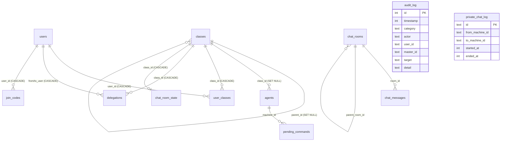

# 💾 SQLite Veritabanı Şeması (Schema v1 - 3'lü Veritabanı Mimarisi)

Okidia platformu; veritabanı şişmelerini engellemek, Master senkronizasyonunda Protobuf 64 MB transfer limitini bertaraf etmek, KVKK/5651 adli delil güvenliğini garanti altına almak ve yüksek frekanslı yazma kilitlerini (write lock) izole etmek için **3 Bağımsız SQLite Veritabanı** mimarisini kullanır:

1. **`okidia.db` (Konfigürasyon & Çekirdek Sistem):**
   - Kullanıcılar, sınıflar, onaylı/bekleyen/engellenmiş ajanlar, öğretmenler, yetkiler, bekleyen komutlar, kilit durumları ve SSH kimlikleri.
   - Boyut: Sabit ~1-2 MB mertebesindedir. Master `DB_BACKUP_REQUEST` ile anında bu dosyayı çeker ve Protobuf sınırlarına takılmaz.
   - *Konum:* `/var/lib/okidia/okidia.db` (Linux) | `C:/ProgramData/Okidia/okidia.db` (Windows) | fallback `~/.local/share/OKIDIA/okidia.db`
2. **`okidia_audit.db` (Adli ve Sistem Denetimi - WORM):**
   - Komut denetim kayıtları (`audit_log`), özel sohbet oturum açılışları (`private_chat_log`), yedekleme (`backup_log`) ve senkronizasyon (`sync_log`) kayıtları.
   - SQLite motoru seviyesinde `BEFORE DELETE` ve `BEFORE UPDATE` tetikleyicileriyle (**WORM - Write Once Read Many**) korunur. YM dahil hiç kimse `ForensicAudit` ve `Security` kategorisindeki adli kayıtları silemez veya değiştiremez.
   - *Konum:* `/var/lib/okidia/okidia_audit.db` (Linux) | `C:/ProgramData/Okidia/okidia_audit.db` (Windows)
3. **`okidia_chat.db` (Sınıf ve Grup Sohbet Geçmişi):**
   - Sohbet odaları (`chat_rooms`) ve mesaj içerikleri (`chat_messages`).
   - KVKK veri minimizasyonu gereği yalnızca Broker sunucusunda saklanır; Master ve Agent üzerine kopyalanmaz.
   - *Konum:* `/var/lib/okidia/okidia_chat.db` (Linux) | `C:/ProgramData/Okidia/okidia_chat.db` (Windows)
4. **`archive/` (Dönen Sıkıştırılmış Arşivler):**
   - 2 haftadan eski sohbet ve denetim kayıtları haftalık olarak `chat_YYYY_wXX.db.gz` ve `audit_YYYY_wXX.db.gz` olarak sıkıştırılır.

---

## 🏛️ Mimari Varlık İlişki Diyagramı (ERD)



---

## 1. `okidia.db` — Konfigürasyon ve Çekirdek Sistem

### 1.1 `meta` (Sistem Metaları)
Sistem ayarlarını, veritabanı şema sürüm bilgisini ve global konfigürasyon anahtarlarını saklar.
```sql
CREATE TABLE IF NOT EXISTS meta (
    key   TEXT PRIMARY KEY,
    value TEXT NOT NULL
);
```
*   *Önemli Anahtarlar:*
    *   `db_version`: Temiz konsolide şema sürümü (`"1"`).
    *   `created_at`: Veritabanının oluşturulma epoch zaman damgası.
    *   `last_modified`: Son konfigürasyon değişikliği zamanı (Master sync tetikleyicisi).
    *   `sec/agent_uninstall_hash`: Windows istemci kaldırma koruma parola hash'i.

### 1.2 `brokers` (Sunucu Kayıtları)
Ağdaki MB (Master Broker) ve SB (Slave Broker) sunucularının durum kayıtlarını tutar.
```sql
CREATE TABLE IF NOT EXISTS brokers (
    id         TEXT PRIMARY KEY,  -- UUID
    hostname   TEXT NOT NULL,
    ip         TEXT NOT NULL,
    role       TEXT NOT NULL DEFAULT 'SB', -- 'MB' | 'SB'
    cert_pem   TEXT,
    last_seen  INTEGER NOT NULL DEFAULT 0,
    created_at INTEGER NOT NULL DEFAULT (unixepoch())
);
```

### 1.3 `users` (Yönetici ve Öğretmenler)
Master yönetim konsoluna giriş yapabilecek YM (Yönetici Master), OM (Öğretmen Master) ve Gözlemci kullanıcı hesaplarıdır.
```sql
CREATE TABLE IF NOT EXISTS users (
    id                TEXT PRIMARY KEY,  -- UUID
    username          TEXT NOT NULL UNIQUE,
    password_hash     TEXT NOT NULL,     -- Argon2id özeti
    role              TEXT NOT NULL,     -- 'YM' | 'OM' | 'OBSERVER'
    display_name      TEXT NOT NULL DEFAULT '',
    must_change_pw    INTEGER NOT NULL DEFAULT 1,
    is_active         INTEGER NOT NULL DEFAULT 1,
    created_by        TEXT,
    created_at        INTEGER NOT NULL DEFAULT (unixepoch()),
    last_login        INTEGER,
    is_backup_replica INTEGER NOT NULL DEFAULT 0, -- 1: Otomatik sistem yedeği kopyası (replika) alabilir
    last_version      TEXT NOT NULL DEFAULT '', -- Master son bağlandığı sürüm (Örn: "0.1.720")
    last_os           TEXT NOT NULL DEFAULT '', -- Master işletim sistemi açık adı (Örn: "Linux Mint 22.1")
    last_os_tag       TEXT NOT NULL DEFAULT '', -- Master paket eşleşme etiketi (Örn: "ubuntu24", "debian12")
    last_arch         TEXT NOT NULL DEFAULT ''  -- Master CPU mimarisi ("x86_64", "arm64")
);
```

### 1.4 `teachers` (Akıllı Tahta Branş Öğretmenleri)
Akıllı tahtalarda mobil QR ve TOTP/HMAC PIN doğrulamasıyla oturum açabilecek öğretmenlerin kimlik ve kriptografik tohum (seed) kayıtlarıdır.
```sql
CREATE TABLE IF NOT EXISTS teachers (
    id           TEXT PRIMARY KEY, -- UUID
    username     TEXT NOT NULL UNIQUE,
    display_name TEXT NOT NULL,
    branch       TEXT NOT NULL DEFAULT '',
    seed_hex     TEXT NOT NULL,    -- 32-bayt HMAC tohumu (HEX)
    password     TEXT NOT NULL DEFAULT '', -- İsteğe bağlı yerel acil durum parolası
    is_active    INTEGER NOT NULL DEFAULT 1,
    created_by   TEXT,
    created_at   INTEGER NOT NULL DEFAULT (unixepoch()),
    updated_at   INTEGER NOT NULL DEFAULT (unixepoch())
);
CREATE INDEX IF NOT EXISTS idx_teachers_username ON teachers(username);
```

### 1.5 `classes` (Sınıf ve Grup Ağacı)
Cihazların hiyerarşik sürükle-bırak sınıf/grup ağacını modelleyen öz-yinelemeli (self-referential) tablodur.
```sql
CREATE TABLE IF NOT EXISTS classes (
    id          TEXT PRIMARY KEY, -- UUID (TreeManager stableId)
    name        TEXT NOT NULL,
    icon        TEXT NOT NULL DEFAULT '🏫',
    type        TEXT NOT NULL DEFAULT 'class', -- 'class' | 'group'
    parent_id   TEXT, -- Üst sınıf/grup UUID'si
    subnet_hint TEXT, -- Opsiyonel IP aralığı ipucu (Örn: "192.168.1.0/24")
    created_by  TEXT,
    created_at  INTEGER NOT NULL DEFAULT (unixepoch()),
    updated_at  INTEGER NOT NULL DEFAULT (unixepoch()),
    FOREIGN KEY (parent_id) REFERENCES classes(id) ON DELETE SET NULL
);
CREATE INDEX IF NOT EXISTS idx_classes_parent ON classes(parent_id);
```
> [!NOTE]
> Bir üst grup silindiğinde alt sınıfların veya grupların kaybolmasını önlemek amacıyla `ON DELETE SET NULL` kuralı uygulanmıştır. Silinen üst grubun altındaki öğeler doğrudan kök seviyeye aktarılır.

### 1.6 `user_classes` (Kullanıcı Sınıf Yetkileri)
Öğretmenlerin (OM) yalnızca kendilerine tanımlanmış sınıfları görmesini sağlayan yetki matrisidir.
```sql
CREATE TABLE IF NOT EXISTS user_classes (
    user_id    TEXT NOT NULL,
    class_id   TEXT NOT NULL,
    permission TEXT NOT NULL DEFAULT 'full', -- 'full' | 'view'
    granted_by TEXT,
    granted_at INTEGER NOT NULL DEFAULT (unixepoch()),
    PRIMARY KEY (user_id, class_id),
    FOREIGN KEY (user_id)  REFERENCES users(id)   ON DELETE CASCADE,
    FOREIGN KEY (class_id) REFERENCES classes(id) ON DELETE CASCADE
);
```

### 1.7 `delegations` (Geçici Yetki Devirleri)
Bir öğretmenin başka bir öğretmene belirli bir sınıf için süre sınırlı olarak yetki devretmesini sağlar.
```sql
CREATE TABLE IF NOT EXISTS delegations (
    id         TEXT PRIMARY KEY, -- UUID
    from_user  TEXT NOT NULL,    -- Yetkiyi devreden user_id
    to_user    TEXT NOT NULL,    -- Yetkiyi alan user_id
    class_id   TEXT NOT NULL,
    type       TEXT NOT NULL,    -- 'full' | 'shared' | 'view'
    starts_at  INTEGER NOT NULL, -- Başlangıç epoch
    ends_at    INTEGER NOT NULL, -- Bitiş epoch
    created_by TEXT NOT NULL,
    created_at INTEGER NOT NULL DEFAULT (unixepoch()),
    FOREIGN KEY (from_user) REFERENCES users(id)   ON DELETE CASCADE,
    FOREIGN KEY (to_user)   REFERENCES users(id)   ON DELETE CASCADE,
    FOREIGN KEY (class_id)  REFERENCES classes(id) ON DELETE CASCADE
);
CREATE INDEX IF NOT EXISTS idx_delegations ON delegations(to_user, ends_at);
```

### 1.8 `agents` (İstemciler / AC — Onaylı, Bekleyen ve Kara Liste)
Sistemde kayıtlı, keşfedilmiş veya engellenmiş tüm uç nokta cihazlarının (AC) merkezi tablosudur.
```sql
CREATE TABLE IF NOT EXISTS agents (
    id             TEXT PRIMARY KEY,           -- Benzersiz Donanım DMI UUID (machineId)
    hostname       TEXT NOT NULL,
    mac            TEXT NOT NULL DEFAULT '',
    ip             TEXT NOT NULL DEFAULT '',
    os_info        TEXT NOT NULL DEFAULT '',
    os_pretty_name TEXT NOT NULL DEFAULT '',   -- Açık OS adı (Örn: "Linux Mint 22", "Windows 11 Pro")
    os_arch        TEXT NOT NULL DEFAULT '',   -- İşlemci mimarisi ("x86_64", "arm64")
    agent_ver      TEXT NOT NULL DEFAULT '',
    class_id       TEXT,                       -- Atandığı sınıf UUID'si
    cert_pem       TEXT,
    agent_type     INTEGER NOT NULL DEFAULT 1, -- 0=Standart, 1=Öğrenci, 2=İdari PC, 3=Akıllı Tahta
    alias          TEXT NOT NULL DEFAULT '',   -- Kullanıcı tanımlı takma ad (Örn: "10-A Sıra 4")
    status         INTEGER NOT NULL DEFAULT 1, -- 0=Beklemede (Pending), 1=Onaylı (Approved), 2=Kara Listede (Blacklisted)
    status_reason  TEXT NOT NULL DEFAULT '',   -- Ret veya kara liste sebebi (Örn: "PENDING_UNINSTALL", "Yetkisiz cihaz")
    approved_by    TEXT,                       -- Onaylayan user_id
    approved_at    INTEGER NOT NULL DEFAULT (unixepoch()),
    last_seen      INTEGER NOT NULL DEFAULT 0,
    FOREIGN KEY (class_id) REFERENCES classes(id) ON DELETE SET NULL
);
CREATE INDEX IF NOT EXISTS idx_agents_class ON agents(class_id);
```
> [!IMPORTANT]
> **Birleşik Kara Liste (Blacklist) Mimarisi:** Eski versiyonlardaki ayrı `blacklist` tablosu tamamen kaldırılarak `agents` tablosu içine entegre edilmiştir. Bir cihaz `status = 2` olduğunda sistem tarafından kara listede kabul edilir ve mDNS/TLS keşif paketleri Broker seviyesinde sessizce düşürülür.

### 1.9 `pending_commands` (Çevrimdışı İstemci Komut Kuyruğu)
İstemci çevrimdışıyken gönderilen komutların, cihaz ağa bağlanıp mTLS oturumu açtığı anda çalıştırılmak üzere bekletildiği kuyruktur.
```sql
CREATE TABLE IF NOT EXISTS pending_commands (
    id          INTEGER PRIMARY KEY AUTOINCREMENT,
    machine_id  TEXT NOT NULL,
    msg_type    INTEGER NOT NULL,
    payload     BLOB NOT NULL, -- Serileştirilmiş Protobuf Envelope bayt dizisi
    created_at  INTEGER NOT NULL DEFAULT (unixepoch()),
    expires_at  INTEGER NOT NULL DEFAULT 0 -- TTL sonu epoch (0 = süresiz)
);
CREATE INDEX IF NOT EXISTS idx_pending_machine ON pending_commands(machine_id);
```

### 1.10 `chat_room_state` (Sohbet Kilit Durumları)
Sınıfların genel ve özel sohbet odalarının kilitli/açık durumunu saklar.
```sql
CREATE TABLE IF NOT EXISTS chat_room_state (
    class_id       TEXT PRIMARY KEY,
    chat_locked    INTEGER NOT NULL DEFAULT 0,
    private_locked INTEGER NOT NULL DEFAULT 0,
    updated_at     INTEGER NOT NULL DEFAULT (unixepoch()),
    FOREIGN KEY (class_id) REFERENCES classes(id) ON DELETE CASCADE
);
```

### 1.11 `ssh_credentials` (SSH Kimlik Bilgileri ve Şablonları)
Uzak kontrollü SSH kurulumlarında ve terminal bağlantılarında kullanılan parola veya özel anahtarların AES şifreli olarak saklandığı tablodur.
```sql
CREATE TABLE IF NOT EXISTS ssh_credentials (
    id          TEXT PRIMARY KEY,           -- UUID
    name        TEXT NOT NULL,              -- Şablon adı (Örn: "Laboratuvar Şablonu")
    username    TEXT NOT NULL,              -- SSH kullanıcı adı (Örn: "ogrenci")
    secret      BLOB NOT NULL,              -- AES-256-GCM ile şifrelenmiş parola veya Private Key
    is_key      INTEGER NOT NULL DEFAULT 0, -- 0=Parola, 1=SSH Private Key
    owner_id    TEXT NOT NULL DEFAULT '',   -- Boş = Ortak şablon, Dolu = Yalnızca ilgili user_id'ye özel
    target_id   TEXT NOT NULL DEFAULT '',   -- Hedef Agent IP veya Sınıf UUID
    target_type TEXT NOT NULL DEFAULT '',   -- 'agent' | 'class'
    machine_id  TEXT NOT NULL DEFAULT '',   -- Ajan bağlandığında eşleşen kalıcı DMI UUID
    created_at  INTEGER NOT NULL DEFAULT (unixepoch())
);
CREATE INDEX IF NOT EXISTS idx_ssh_owner  ON ssh_credentials(owner_id);
CREATE INDEX IF NOT EXISTS idx_ssh_target ON ssh_credentials(target_id);
```

### 1.12 `join_codes` (Öğretmen Katılım Davet Kodları)
Yöneticilerin öğretmenleri sisteme dahil etmek için oluşturduğu tek kullanımlık, süreli davet kodlarıdır.
```sql
CREATE TABLE IF NOT EXISTS join_codes (
    code       TEXT PRIMARY KEY, -- Biçim: JOIN-XXXX-YYYY
    user_id    TEXT NOT NULL,    -- Davet edilen kullanıcı UUID'si
    expires_at INTEGER NOT NULL,
    used_at    INTEGER NOT NULL DEFAULT 0,
    FOREIGN KEY (user_id) REFERENCES users(id) ON DELETE CASCADE
);
```

---

## 2. `okidia_audit.db` — Adli ve Sistem Denetimi (WORM)

### 2.1 `meta` (Denetim Metaları)
Denetim log saklama politikalarını (`audit_retention_days`, `archive_retention_days`) tutar.
```sql
CREATE TABLE IF NOT EXISTS meta (
    key   TEXT PRIMARY KEY,
    value TEXT NOT NULL
);
```

### 2.2 `audit_log` (Adli ve Yönetimsel Denetim Kütüğü)
Master konsollarından gönderilen komutlar, kilit açma/kapama, oturum ve sistem olaylarının kaydedildiği tablodur.
```sql
CREATE TABLE IF NOT EXISTS audit_log (
    id         INTEGER PRIMARY KEY AUTOINCREMENT,
    timestamp  INTEGER NOT NULL DEFAULT (unixepoch()),
    category   TEXT NOT NULL DEFAULT 'Command', -- 'Command', 'Security', 'ForensicAudit', 'System'
    actor      TEXT NOT NULL,                   -- İşlemi yapan kullanıcı adı
    user_id    TEXT NOT NULL DEFAULT '',        -- OKIDIA users.id UUID
    master_id  TEXT NOT NULL DEFAULT '',        -- Komutu gönderen Master soket/cihaz ID
    target     TEXT NOT NULL DEFAULT '',        -- Hedef machine_id veya Sınıf adı
    detail     TEXT NOT NULL DEFAULT ''         -- Detaylı komut içeriği veya parametreler
);
CREATE INDEX IF NOT EXISTS idx_audit_time     ON audit_log(timestamp);
CREATE INDEX IF NOT EXISTS idx_audit_actor    ON audit_log(actor);
CREATE INDEX IF NOT EXISTS idx_audit_user     ON audit_log(user_id);
CREATE INDEX IF NOT EXISTS idx_audit_cat_time ON audit_log(category, timestamp);
CREATE INDEX IF NOT EXISTS idx_audit_target   ON audit_log(target);
```

#### 🛡️ SQLite WORM Tetikleyicileri (Write Once, Read Many)
5651 ve adli delil güvenliği gereğince, `ForensicAudit` ve `Security` kategorisindeki kayıtlar veritabanı motoru seviyesinde kilitlenir. Yönetici (YM) dahil hiç kimse bu kayıtları silemez veya güncelleyemez:
```sql
CREATE TRIGGER IF NOT EXISTS trg_prevent_forensic_audit_delete
BEFORE DELETE ON audit_log
WHEN OLD.category IN ('ForensicAudit', 'Security')
BEGIN
    SELECT RAISE(FAIL, 'Adli denetim kayıtları YM dahil hiçbir kullanıcı veya komut tarafından silinemez!');
END;

CREATE TRIGGER IF NOT EXISTS trg_prevent_forensic_audit_update
BEFORE UPDATE ON audit_log
WHEN OLD.category IN ('ForensicAudit', 'Security')
BEGIN
    SELECT RAISE(FAIL, 'Adli denetim kayıtları üzerinde sonradan değişiklik yapılamaz!');
END;
```

### 2.3 `private_chat_log` (Özel Sohbet Oturum Kayıt Defteri)
İki cihaz arasındaki özel mesajlaşmaların **sadece meta verilerini** (oturum başlangıç/bitiş) tutar. KVKK ve veri minimizasyonu gereği mesajların asıl içerikleri hiçbir zaman kaydedilmez.
```sql
CREATE TABLE IF NOT EXISTS private_chat_log (
    id              TEXT PRIMARY KEY, -- UUID
    from_machine_id TEXT NOT NULL,    -- Başlatan cihaz DMI UUID
    from_host       TEXT NOT NULL,
    from_user       TEXT NOT NULL,
    to_machine_id   TEXT NOT NULL,    -- Hedef cihaz DMI UUID
    to_host         TEXT NOT NULL,
    to_user         TEXT NOT NULL,
    started_at      INTEGER NOT NULL DEFAULT (unixepoch()),
    ended_at        INTEGER           -- Oturum kapandığında epoch, devam ediyorsa NULL
);
CREATE INDEX IF NOT EXISTS idx_pclog_from ON private_chat_log(from_machine_id);
CREATE INDEX IF NOT EXISTS idx_pclog_to   ON private_chat_log(to_machine_id);
```

### 2.4 `sync_log` (Veritabanı Replikasyon Geçmişi)
Master konsolları ile Broker arasındaki `okidia.db` senkronizasyonlarının kaydıdır.
```sql
CREATE TABLE IF NOT EXISTS sync_log (
    id            INTEGER PRIMARY KEY AUTOINCREMENT,
    master_id     TEXT NOT NULL,
    synced_at     INTEGER NOT NULL DEFAULT (unixepoch()),
    tables_synced TEXT NOT NULL DEFAULT '',
    delta_count   INTEGER NOT NULL DEFAULT 0
);
```

### 2.5 `backup_log` (Yedekleme Kayıtları)
Broker tarafından alınan yerel ve replika yedekleme işlemlerinin durumunu tutar.
```sql
CREATE TABLE IF NOT EXISTS backup_log (
    id         INTEGER PRIMARY KEY AUTOINCREMENT,
    created_at INTEGER NOT NULL DEFAULT (unixepoch()),
    sent_to    TEXT NOT NULL, -- Yedek dosyasının gönderildiği hedef / Master
    file_size  INTEGER NOT NULL DEFAULT 0,
    checksum   TEXT NOT NULL DEFAULT '',
    success    INTEGER NOT NULL DEFAULT 0
);
```

---

## 3. `okidia_chat.db` — Grup Sohbet Odaları ve Mesajlaşma

### 3.1 `meta` (Sohbet Metaları)
Sohbet geçmişi saklama süresini (`chat_retention_days = 14`) tutar.
```sql
CREATE TABLE IF NOT EXISTS meta (
    key   TEXT PRIMARY KEY,
    value TEXT NOT NULL
);
```

### 3.2 `chat_rooms` (Sohbet Odaları)
Sınıflar, alt gruplar veya genel laboratuvar kanalları için oluşturulmuş sohbet odalarıdır.
```sql
CREATE TABLE IF NOT EXISTS chat_rooms (
    id             TEXT PRIMARY KEY, -- UUID
    name           TEXT NOT NULL,
    class_id       TEXT,             -- İlişkili sınıf UUID'si (mantıksal referans)
    parent_room_id TEXT,             -- Üst oda UUID'si
    permanent      INTEGER NOT NULL DEFAULT 0,
    created_by     TEXT,
    created_at     INTEGER NOT NULL DEFAULT (unixepoch())
);
```

### 3.3 `chat_messages` (Mesaj Geçmişi)
Sohbet odalarındaki metin mesajlarını tutar. Varsayılan olarak 14 gün sonra `archiveOldChat` ile haftalık sıkıştırılmış arşive taşınır.
```sql
CREATE TABLE IF NOT EXISTS chat_messages (
    id          TEXT PRIMARY KEY, -- UUID
    room_id     TEXT NOT NULL,
    from_host   TEXT NOT NULL,
    sender_role INTEGER NOT NULL DEFAULT 0, -- 0=Öğrenci, 1=Öğretmen, 2=Sistem
    content     TEXT NOT NULL,
    timestamp   INTEGER NOT NULL,
    is_system   INTEGER NOT NULL DEFAULT 0
);
CREATE INDEX IF NOT EXISTS idx_msg_room_time ON chat_messages(room_id, timestamp);
```

---

## 4. C++ Veritabanı Motorları ve Singleton Mimarisi

Tüm veritabanı sorguları, Qt'nin `QSqlDatabase` altyapısını saran thread-safe C++ Singleton sınıfları üzerinden yönetilir:

```
common/db/
├── OkidiaDatabase.h / .cpp       -> okidia.db (Çekirdek Sistem, İstemciler, Sınıflar, Kullanıcılar)
├── OkidiaAuditDatabase.h / .cpp  -> okidia_audit.db (WORM Adli Log, Replikasyon, Özel Sohbet Metası)
├── OkidiaChatDatabase.h / .cpp   -> okidia_chat.db (Sohbet Odaları ve Mesajlar)
└── DbRecords.h                   -> Tüm tablolara karşılık gelen modern C++ POD struct yapıları
```

### 4.1 `OkidiaDatabase` API Özeti
- **İstemci Yönetimi:** `upsertAgent`, `removeAgent`, `agent`, `allAgents`, `updateAgentClass`, `updateAgentAlias`, `updateAgentType`, `updateAgentLastSeen`.
- **Kara Liste:** `addToBlacklist`, `removeFromBlacklist`, `isBlacklisted`, `blacklist` (tümü `agents` tablosu `status = 2` üzerinden yürütülür).
- **Kullanıcı & Yetki:** `upsertUser`, `removeUser`, `userById`, `userByUsername`, `setUserPassword`, `updateLastLogin`, `setUserBackupReplica`.
- **Akıllı Tahta:** `upsertTeacher`, `removeTeacher`, `teacherById`, `teacherByUsername`, `allTeachers`.
- **Sınıf Ağacı:** `upsertClass`, `removeClass`, `classById`, `allClasses`, `classesByParent`, `setUserClassPermission`.
- **Komut Kuyruğu & SSH:** `addPendingCommand`, `pendingCommands`, `deletePendingCommand`, `upsertSshCredential`, `allSshCredentials`.

### 4.2 `OkidiaAuditDatabase` API Özeti
- **Adli Log:** `logCommand(actor, target, detail, category, userId, masterId, timestamp)`, `queryAuditLogAdvanced`, `purgeAuditLog`.
- **Özel Sohbet:** `logPrivateChatSession(sessionId, ...)`, `closePrivateChatSession(sessionId)`.
- **Replikasyon & WORM:** `vacuumInto(targetPath)`, `flushQueue()`, `auditRetentionDays()`.

### 4.3 `OkidiaChatDatabase` API Özeti
- **Odalar & Mesajlar:** `saveChatRoom`, `deleteChatRoom`, `saveChatMessage`, `getChatMessages(roomId, limit, beforeTimestamp)`.
- **Dönen Arşiv:** `archiveOldChat`, `purgeChatMessages`, `chatRetentionDays`.

---

## 5. Şema Sürümleme ve Migration Mimarisi

Veritabanı bağlantısı açıldığında (`OkidiaDatabase::open()`), dosya içindeki `db_version` meta değeri ile derlenmiş koddaki `kCurrentSchemaVersion` karşılaştırılır:

```cpp
// common/db/OkidiaDatabase.h
static constexpr int kCurrentSchemaVersion = 1;
```

Projede geliştirme aşamasındaki tüm ara `ALTER TABLE` geçişleri temizlenerek üretim öncesi standart **v1** temel şeması olarak konsolide edilmiştir. `createSchema()` fonksiyonu ilk çalıştırmada tüm tabloları ve indeksleri en güncel yapısıyla oluşturur. İlerleyen sürümlerde yapılacak şema genişletmeleri bu sağlam v1 temeli üzerine artımlı (incremental) migration fonksiyonlarıyla eklenecektir.
